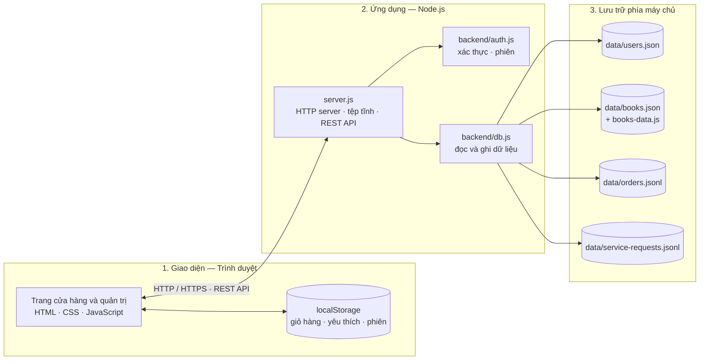

# BookNest

[](https://github.com/duongcongcao-0312/duannhom5-main/actions/workflows/ci.yml)
[](https://nodejs.org/)

BookNest là website nhà sách trực tuyến bằng tiếng Việt, xây dựng với HTML,
CSS, JavaScript thuần và máy chủ REST API chạy trên Node.js. Dự án minh hoạ
quy trình duyệt sách, đặt hàng và vận hành một cửa hàng sách trực tuyến.

## Mục lục

- [Tính năng](#tính-năng)
- [Công nghệ](#công-nghệ)
- [Cài đặt và chạy](#cài-đặt-và-chạy)
- [Cổng quản trị](#cổng-quản-trị)
- [Kiểm thử](#kiểm-thử)
- [API](#api)
- [Dữ liệu và lưu trữ](#dữ-liệu-và-lưu-trữ)
- [Cấu trúc dự án](#cấu-trúc-dự-án)
- [Kiến trúc phần mềm](#kiến-trúc-phần-mềm)
- [Yêu cầu phi chức năng](#yêu-cầu-phi-chức-năng)
- [Bảo mật của hệ thống](#bảo-mật-của-hệ-thống)
- [Thành viên và đóng góp](#thành-viên-và-đóng-góp)
- [Lưu ý bảo mật](#lưu-ý-bảo-mật)

## Tính năng

- Duyệt danh mục 80 đầu sách thuộc 10 thể loại; tìm theo tên hoặc tác giả,
  lọc thể loại và sắp xếp theo giá hoặc tên.
- Xem chi tiết sách, sách liên quan và đánh dấu sách yêu thích.
- Thêm sách vào giỏ, cập nhật số lượng, áp dụng mã ưu đãi và xem tổng tiền.
- Đặt hàng bằng chuyển khoản qua mã QR hoặc thanh toán khi nhận hàng (COD);
  máy chủ kiểm tra giá, lưu đơn và cấp mã để tra cứu.
- Đăng ký thuê, thu mua hoặc trao đổi sách; đăng ký tài khoản và đăng nhập.
- Quản lý đơn hàng, kho sách, yêu cầu dịch vụ và thành viên qua cổng quản trị.
- Giao diện tương thích với máy tính và điện thoại; có trang chi tiết sách,
  chính sách, điều khoản và trang lỗi.

## Công nghệ

- **Giao diện:** HTML, CSS và JavaScript thuần.
- **Máy chủ:** Node.js, HTTP API và lưu trữ dữ liệu dạng JSON/JSONL.
- **Kiểm thử:** Node.js test runner (`node:test`).
- **Tự động hoá:** GitHub Actions chạy kiểm thử và kiểm tra dependency.

## Cài đặt và chạy

Cần cài [Node.js 20 trở lên](https://nodejs.org/). Từ thư mục dự án, chạy:

```sh
npm ci
npm start
```

Mở <http://127.0.0.1:8000>. Máy chủ mặc định chỉ lắng nghe trên máy hiện tại.
Có thể cấu hình `PORT` và `HOST` nếu cần. Ví dụ trong PowerShell:

```powershell
$env:PORT = "8000"
$env:HOST = "127.0.0.1"
npm start
```

## Xuất bản GitHub Pages

Workflow `Deploy BookNest to GitHub Pages` tự động xuất bản giao diện khi có
thay đổi trên nhánh `main`. URL mặc định của dự án là
<https://duongcongcao-0312.github.io/duannhom5-main/>. Nếu GitHub yêu cầu,
hãy đặt Settings > Pages > Build and deployment > Source thành GitHub Actions.

GitHub Pages chỉ phục vụ giao diện tĩnh; API Node.js không chạy trên Pages nên
đăng ký tài khoản qua API, đặt hàng và quản trị cần máy chủ backend riêng.
Build Pages chỉ chép danh sách file giao diện cho phép, không xuất bản `data/`
hay mã máy chủ. Để Google/Facebook Auth hoạt động trên Pages, cần thêm
`duongcongcao-0312.github.io` vào Authorized domains trong Firebase Console.

## Cổng quản trị

Mở <http://127.0.0.1:8000/admin.html> để đăng nhập và quản lý cửa hàng. Tài
khoản demo được khởi tạo khi chưa có tệp người dùng:

- **Email:** `admin@booknest.vn`
- **Mật khẩu:** `admin123`

Đây là thông tin đăng nhập dành riêng cho môi trường phát triển cục bộ; không
đưa máy chủ ra mạng công cộng khi còn sử dụng tài khoản mặc định.

## Kiểm thử

```sh
npm test
npm audit --omit=dev
```

GitHub Actions tự động cài dependency theo lockfile, chạy kiểm thử và kiểm tra
lỗ hổng dependency khi có push lên nhánh `main` hoặc pull request vào `main`.

## API

| Phương thức | Đường dẫn | Quyền hạn | Mô tả |
| --- | --- | --- | --- |
| `GET` | `/api/coupons/:code` | Công khai | Kiểm tra mã ưu đãi |
| `POST` | `/api/orders` | Công khai | Xác thực và lưu đơn hàng |
| `GET` | `/api/orders/:id` | Công khai | Tra cứu trạng thái và chi tiết cơ bản của đơn |
| `POST` | `/api/auth/register` | Công khai | Đăng ký tài khoản |
| `POST` | `/api/auth/login` | Công khai | Đăng nhập và nhận token |
| `GET` | `/api/auth/me` | Người dùng | Lấy thông tin tài khoản hiện tại |
| `POST` | `/api/auth/logout` | Người dùng | Đăng xuất |
| `GET` | `/api/books` | Công khai | Lấy danh mục sách |
| `POST` | `/api/services` | Công khai | Gửi yêu cầu thuê, thu mua hoặc trao đổi sách |
| `GET` | `/api/admin/stats` | Quản trị | Xem thống kê |
| `GET` | `/api/admin/orders` | Quản trị | Xem danh sách đơn hàng |
| `PATCH` | `/api/admin/orders/:id` | Quản trị | Cập nhật trạng thái đơn và thanh toán |
| `POST` | `/api/admin/books` | Quản trị | Thêm sách |
| `PUT` | `/api/admin/books/:id` | Quản trị | Cập nhật sách và tồn kho |
| `DELETE` | `/api/admin/books/:id` | Quản trị | Xoá sách |
| `GET` | `/api/admin/services` | Quản trị | Xem yêu cầu dịch vụ |
| `PATCH` | `/api/admin/services/:id` | Quản trị | Cập nhật trạng thái yêu cầu dịch vụ |
| `GET` | `/api/admin/users` | Quản trị | Xem danh sách thành viên |

## Dữ liệu và lưu trữ

Máy chủ lưu người dùng trong `data/users.json`, yêu cầu dịch vụ trong
`data/service-requests.jsonl`, sách quản trị thêm trong `data/books.json` và
đơn hàng trong `data/orders.jsonl`. Một số trạng thái giao diện như giỏ hàng,
sách yêu thích và phiên đăng nhập cũng được lưu trong `localStorage` của trình
duyệt.

`data/orders.jsonl` được bỏ qua bởi Git vì có thể chứa thông tin giao nhận.
Không đưa dữ liệu khách hàng thật hoặc thông tin nhạy cảm vào repository; hãy
bảo vệ và sao lưu các tệp dữ liệu phù hợp với nhu cầu triển khai.

## Cấu trúc dự án

```text
.
├── assets/                  # Biểu tượng và tài nguyên tĩnh
├── backend/
│   ├── auth.js              # Mã hoá mật khẩu và quản lý phiên
│   └── db.js                # Đọc và ghi dữ liệu JSON/JSONL
├── data/                    # Dữ liệu người dùng, sách và yêu cầu dịch vụ
├── tests/                   # Kiểm thử giao diện và API
├── .github/workflows/       # Quy trình CI
├── admin.html               # Giao diện cổng quản trị
├── admin.css                # Kiểu dáng cổng quản trị
├── admin.js                 # Tương tác và gọi API quản trị
├── book.html                # Trang chi tiết sách
├── book-detail.js           # Tương tác trang chi tiết
├── books-data.js            # Danh mục sách mặc định
├── index.html               # Trang chủ cửa hàng
├── main.css                 # Kiểu dáng cửa hàng
├── main.js                  # Tương tác giao diện cửa hàng
├── server.js                # Máy chủ REST API và tệp tĩnh
└── package.json             # Lệnh dự án
```

## Kiến trúc phần mềm

BookNest hiện chạy theo kiến trúc client–server gọn nhẹ. Trình duyệt gửi yêu
cầu HTTP đến máy chủ Node.js; máy chủ phục vụ giao diện tĩnh và xử lý REST API.
Các API dùng thành phần xác thực và lớp đọc/ghi dữ liệu để hoàn tất nghiệp vụ.



| Thành phần | Trách nhiệm | Thành phần mã nguồn |
| --- | --- | --- |
| Giao diện | Hiển thị cửa hàng/cổng quản trị; gửi request đến API; lưu một số trạng thái giao diện trên trình duyệt | `index.html`, `admin.html`, `main.js`, `admin.js`, `localStorage` |
| Máy chủ ứng dụng | Phục vụ tệp tĩnh, nhận API request và điều phối xử lý nghiệp vụ | `server.js` |
| Xác thực và phiên | Xử lý đăng nhập, mật khẩu và phiên người dùng | `backend/auth.js` |
| Truy cập dữ liệu | Đọc/ghi dữ liệu ứng dụng dưới dạng JSON hoặc JSONL | `backend/db.js`, thư mục `data/` |
| Danh mục sách mặc định | Cung cấp dữ liệu sách khởi tạo/đóng gói cùng mã nguồn | `books-data.js` |

### Luồng xử lý request

1. Người dùng thao tác trên giao diện cửa hàng hoặc trang quản trị.
2. Frontend gửi request đến `server.js` qua REST API; request trang cũng được
   máy chủ dùng để phục vụ các tệp tĩnh.
3. Với API cần đăng nhập, máy chủ xác thực phiên và kiểm tra quyền trước khi
   thực hiện thao tác.
4. Máy chủ xử lý nghiệp vụ, gọi lớp truy cập dữ liệu khi cần, rồi trả kết quả
   về trình duyệt.
5. Trạng thái giao diện như giỏ hàng và sách yêu thích được lưu ở
   `localStorage`; đây không phải kho dữ liệu đáng tin cậy cho nghiệp vụ hoặc
   dữ liệu cần bảo vệ.

**Phạm vi hiện tại:** đây là ứng dụng Node.js một tiến trình, dùng tệp JSON/JSONL
để lưu dữ liệu. `localStorage` nằm ở trình duyệt, tách biệt với dữ liệu phía
máy chủ. Kiến trúc phù hợp cho demo và quy mô nhỏ; khi triển khai thực tế hoặc
cần nhiều người dùng đồng thời, nên chuyển sang cơ sở dữ liệu có giao dịch,
tách nghiệp vụ thành các module rõ ràng và bổ sung giám sát/sao lưu phù hợp.

## Yêu cầu phi chức năng

Dưới đây là các yêu cầu phi chức năng phù hợp với mức độ của dự án BookNest:

- Hiệu năng: trang chủ và danh sách sách cần tải nhanh trong môi trường local
  hoặc server vừa phải; số lượng dữ liệu mẫu nên giới hạn trong phạm vi hợp lý
  để giữ thời gian phản hồi thấp.
- Khả năng mở rộng: hệ thống nên dễ thêm thể loại sách, trường dữ liệu, API mới
  mà không cần sửa nhiều điểm trung tâm.
- Tính sẵn sàng: máy chủ cần chạy ổn định trong thời gian dài; khi lưu dữ liệu
  vào file cần tránh race condition khi có nhiều request đồng thời.
- Tính khả dụng trên thiết bị: giao diện cần tương thích với máy tính và điện
  thoại, giữ bố cục rõ ràng ở màn hình nhỏ.
- Khả năng bảo trì: code nên tách rõ phần view, API và dữ liệu; mỗi chức năng có
  cấu trúc mô-đun dễ kiểm tra và mở rộng.
- Độ tin cậy: cập nhật đơn hàng, thanh toán và kho hàng cần tránh trạng thái
  không nhất quán; mỗi thao tác quan trọng nên có kiểm tra xác thực và dữ liệu.
- Bảo mật dữ liệu: thông tin người dùng, đơn hàng và token phải được lưu và xử lý
  đúng cách, tránh rò rỉ hay lộ ra khi triển khai môi trường công cộng.
- Khả năng kiểm thử: API và luồng chính cần có bộ kiểm thử tự động để đảm bảo
  không phá vỡ chức năng khi phát triển thêm.

## Bảo mật của hệ thống

BookNest ở phiên bản demo hiện có một số biện pháp cơ bản, nhưng vẫn cần được
cải thiện trước khi vận hành thực tế:

- Mã hoá mật khẩu: mật khẩu cần được băm bằng thuật toán thích hợp như bcrypt
  hoặc Argon2 thay vì lưu ở dạng văn bản thuần.
- Quản lý phiên: token hoặc session nên có thời gian sống, có chữ ký và được
  lưu an toàn; không nên để token ở dạng dễ khai thác trên client.
- Xác thực và phân quyền: API quản trị chỉ được truy cập bởi người dùng có role
  quản trị; các route quan trọng phải kiểm tra quyền trước khi thực thi.
- Kiểm tra đầu vào: dữ liệu từ form, URL và request body cần được validate để
  tránh lỗi, tấn công injection hoặc payload bất thường.
- Giới hạn truy cập: nên ánh xạ `HOST` và `PORT`, đóng service trên localhost khi
  phát triển; không mở node server trực tiếp trên internet nếu chưa có HTTPS và
  quy trình bảo mật đầy đủ.
- Bảo vệ dữ liệu nhạy cảm: không lưu dữ liệu thật, mật khẩu, thông tin giao
  nhận hoặc token vào repository; các file JSON nên giữ riêng trong môi trường
  triển khai có phân quyền.
- HTTPS và bảo mật truyền tải: khi triển khai thực tế, bắt buộc dùng HTTPS để
  mã hoá dữ liệu giữa browser và server.
- Sao lưu và phục hồi: dữ liệu người dùng, đơn hàng và sách cần có sao lưu định
  kỳ và quy trình khôi phục sự cố.
- Rà soát dependency: dùng `npm audit` và cập nhật các gói liên quan nhằm giảm
  rủi ro lỗ hổng trong thư viện bên thứ ba.

Các nguyên tắc bảo mật khuyến nghị:

1. Không để tài khoản admin mặc định ở môi trường production.
2. Không công khai file dữ liệu nhạy cảm trên GitHub hoặc shared storage.
3. Giới hạn quyền truy cập file hệ thống và thư mục data theo user/service account.
4. Báo cáo và xử lý lỗi không lộ stack trace, password hay thông tin nhạy cảm.
5. Có nhật ký sự kiện (audit log) cho đăng nhập, cập nhật đơn hàng và thay đổi
   quyền quản trị.

## Thành viên và đóng góp

Thông tin dưới đây được tổng hợp từ commit và issue trên GitHub. Tên hiển thị
là tài khoản GitHub; phần đóng góp mô tả các hạng mục và khu vực mã nguồn có
thể đối chiếu, không phải chức danh chính thức.

| Thành viên | Công việc ghi nhận |
| --- | --- |
| [@duongcongcao-0312](https://github.com/duongcongcao-0312) | Khởi tạo và cập nhật dự án; phát triển luồng lưu và tra cứu đơn hàng, cập nhật tài liệu. [Issue #1](https://github.com/duongcongcao-0312/duannhom5-main/issues/1) |
| [@daoducanh1](https://github.com/daoducanh1) | Đóng góp cho phần máy chủ Node.js trong `server.js`; commit gắn với hạng mục đăng nhập/xác thực. [Issue #2](https://github.com/duongcongcao-0312/duannhom5-main/issues/2) |
| [@vothanhdat1th3-pixel](https://github.com/vothanhdat1th3-pixel) | Đóng góp cho logic giao diện trong `main.js`, bao gồm luồng biểu mẫu dịch vụ thuê, thu mua và trao đổi sách. [Issue #3](https://github.com/duongcongcao-0312/duannhom5-main/issues/3) |
| [@nguyennhatanh1427-gif](https://github.com/nguyennhatanh1427-gif) | Phát triển tương tác giỏ hàng, trang chi tiết sách và giao diện; bổ sung/cập nhật kiểm thử. [Issue #4](https://github.com/duongcongcao-0312/duannhom5-main/issues/4), [#6](https://github.com/duongcongcao-0312/duannhom5-main/issues/6), [#7](https://github.com/duongcongcao-0312/duannhom5-main/issues/7) |
| [@HoangAnhdzvcl](https://github.com/HoangAnhdzvcl) | Đóng góp cho danh sách và chức năng sắp xếp sách theo giá, cùng các cập nhật liên quan ở giao diện, máy chủ và kiểm thử. [Issue #5](https://github.com/duongcongcao-0312/duannhom5-main/issues/5) |

## Lưu ý bảo mật

BookNest là dự án mẫu, chưa được thiết kế để vận hành với dữ liệu khách hàng
thật. Tài khoản demo mặc định, lưu trữ JSON trên đĩa, token phiên trong bộ nhớ
và một số thông tin phía trình duyệt không thay thế cho quy trình bảo mật của
một dịch vụ thương mại.

Trước khi triển khai thực tế, cần thay đổi cơ chế quản trị mặc định, dùng cơ
sở dữ liệu phù hợp có sao lưu, bật HTTPS, rà soát quyền truy cập và bổ sung
các biện pháp bảo vệ dữ liệu cá nhân. Máy chủ Node.js cần môi trường lưu trữ
được dữ liệu lâu dài; GitHub Pages chỉ phục vụ tệp tĩnh và không chạy được API.

## Google and Facebook registration

The registration form uses Firebase Authentication popups for Google and
Facebook. Set the Firebase web app values in `assets/firebase-config.js` from
Firebase Console > Project settings > Your apps. These browser configuration
values are public; never put a provider client secret in this file.

Enable Google and Facebook under Firebase Authentication > Sign-in method, add
`sachlatrithuc.com` under Authorized domains, and configure each provider's
OAuth app with Firebase's redirect URI shown in its provider settings. Serve the
site over HTTPS (or localhost while developing). The Facebook App ID and secret
belong only in Firebase Console.
